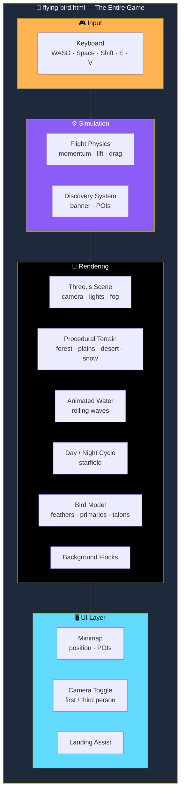
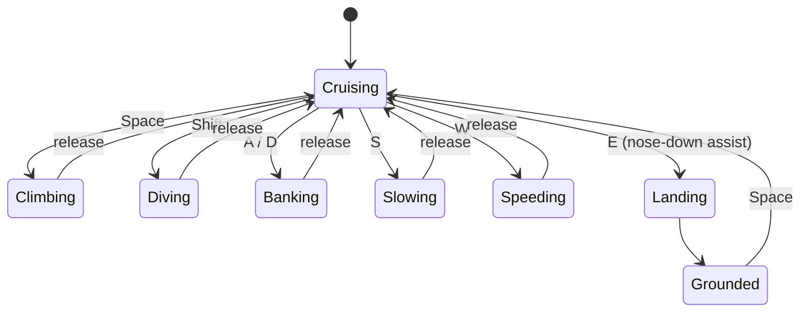

# 🐦 Flying Bird — Browser Prototype

<div align="center">


**A single-file, self-contained browser flight game.**

*Three.js + WebGL — no engine project, no scene files, no asset pipeline*

[🎮 Play Now](#-play-now) • [⌨️ Controls](#-controls) • [✨ What's In This Build](#-whats-in-this-build) • [🚫 What's Not](#-whats-not-in-this-build)

</div>

---

## 📖 Overview

**Flying Bird** is a **single-file, self-contained browser game** built with **Three.js + WebGL**.

> ⚠️ **This is NOT a Unity project.**
>
> There is **no separate engine project, scene files, or asset pipeline** behind it. This zip contains just **the one playable file** plus a README.

### Core Idea

> **One HTML file. One library. Everything else, generated in the browser.**
>
> Terrain, water, sky, the bird itself, and the flocks around it are all **procedural**. Nothing to load, nothing to break, nothing to license.

---

## 🎮 Play Now

### Hosted Version

**▶ [Play Flying Bird in your browser →](https://claude.ai/artifact/D8GeDyHwh6i33CtMPbfGyV)**

### Run Locally

**Double-click `flying-bird.html`** — or drag it into any modern desktop browser:

- Chrome · Edge · Firefox · Safari

> 💡 **Needs an internet connection once**, to load the Three.js library from a CDN.

---

## ⌨️ Controls

| Key | Action |
|-----|--------|
| **W / S** | Speed up / slow down |
| **A / D** | Turn left / right |
| **Space** | Climb |
| **Shift** | Dive |
| **E** | Gentle nose-down landing assist |
| **V** | Toggle first-person / third-person camera |

---

## ✨ What's In This Build

<div align="center">

| 🌍 Procedural Terrain | 🌊 Animated Water |
|:---:|:---:|
| Forest · plains · desert · snow biome regions | Rolling waves |
| **🌅 Day / Night Cycle** | **🐦 Detailed Bird** |
| Full cycle with a fading starfield | Layered tail feathers · spreading wing primaries · talons · eyes |
| **✈️ Flight Physics** | **👥 Background Flocks** |
| Momentum · lift · drag · banking turns | Birds circling the sky around you |
| **🗺️ Minimap** | **📢 Discovery System** |
| Top-right, tracking your position and points of interest | "New area discovered" banner as you explore |
| **📍 11 Named POIs** | **🗼 One Large Landmark** |
| Points of interest scattered across the world | A landmark spire to fly toward |

</div>

### 🌍 The World

- **Procedurally generated terrain** with distinct biome regions:
  - **Forest**
  - **Plains**
  - **Desert**
  - **Snow**
- **Animated water** with rolling waves
- **Full day/night cycle** with a **fading starfield**

### 🐦 The Bird

- **Layered tail feathers**
- **Spreading wing primaries**
- **Talons**
- **Eyes**

Driven by:

- **Momentum**
- **Lift**
- **Drag**
- **Banking turns**

### 👥 Background Flocks

Birds **circling the sky** around you — the world feels alive even before you move.

### 🗺️ Minimap

A **top-right minimap** tracking:

- Your **position**
- **Points of interest**

Plus a **"new area discovered"** banner as you explore.

### 📍 Points of Interest

**11 named POIs** and **one large landmark spire** — something to fly toward.

---

## 🚫 What's Not In This Build

> **By design, to keep it running well.**

| Feature | Status |
|---------|:------:|
| Villages with NPCs | ❌ Not built |
| Ground wildlife — deer, wolves, etc. | ❌ Not built |
| Weather — rain, storms, fog | ❌ Not built |
| Missions and a full progression / customization system | ❌ Not built |
| Full-screen zoomable world map | ❌ Not built |
| True chunk-streamed terrain for a 20 km+ world | ❌ Not built |

> 💡 **These are all reasonable next steps if you want to keep building this out.**

---

## 🏗️ Architecture

### Everything in One File



### Flight Physics — State Flow



### Design Principles

<div align="center">

| Principle | Implementation |
|-----------|---------------|
| **📄 One file, zero dependencies** | The whole game is `flying-bird.html` — portable, shareable, no build step |
| **🎨 Procedural everything** | Terrain, water, sky, bird, and flocks are all generated at runtime — no external assets |
| **🌍 Biome regions from noise** | Forest, plains, desert, and snow emerge from the same procedural terrain |
| **🐦 Flight that feels like flight** | Momentum, lift, drag, and banking turns — not scripted motion |
| **🗺️ Orientation is built in** | Minimap, POI tracking, and discovery banners keep you oriented in an open world |
| **🎥 Camera flexibility** | First-person and third-person with one key — the game trusts you to choose |
| **🚫 No fake features** | Nothing pretends to exist. If it's not built, it's listed in **What's Not In This Build** |
| **📦 No external audio or assets** | Nothing to load, nothing to license |

</div>

### File Structure

```
flying-bird/
├── flying-bird.html      # The entire game — markup, styles, and all JS in one file
└── README.md             # This file
```

> 💡 **Everything lives inside `flying-bird.html`.** It's kept as one file so it's **trivially portable**.

---

## 🗺️ Roadmap

### ✅ Current

- [x] Single-file, self-contained browser game
- [x] Three.js + WebGL rendering
- [x] Procedurally generated terrain
- [x] Four biome regions — forest, plains, desert, snow
- [x] Animated water with rolling waves
- [x] Full day/night cycle with fading starfield
- [x] Detailed bird with layered tail feathers, spreading wing primaries, talons, and eyes
- [x] Momentum / lift / drag flight physics
- [x] Banking turns
- [x] Background flocks of birds circling the sky
- [x] Top-right minimap with position and POI tracking
- [x] "New area discovered" banner
- [x] 11 named points of interest
- [x] One large landmark spire
- [x] First-person / third-person camera toggle
- [x] Gentle nose-down landing assist
- [x] Hosted playable version

### 🔜 Future Ideas

- [ ] Villages with NPCs
- [ ] Ground wildlife — deer, wolves, etc.
- [ ] Weather — rain, storms, fog
- [ ] Missions and a full progression system
- [ ] Customization system
- [ ] Full-screen zoomable world map
- [ ] True chunk-streamed terrain for a 20 km+ world
- [ ] Additional biomes and landmarks
- [ ] Time-of-day presets
- [ ] Photo mode

---

## 🤝 Contributing

Contributions are welcome. Please:

1. Fork the repository
2. **Keep it single-file** — no external build step, no bundler
3. **Keep it procedural** — no external assets
4. **Preserve the flight feel** — momentum, lift, drag, and banking are the core
5. **Keep the minimap honest** — it should reflect what's actually in the world
6. Test in a WebGL-capable browser
7. Submit a Pull Request

### Guidelines

- **Never add a required external dependency** beyond Three.js
- **Never require a build step** — `flying-bird.html` and nothing else
- **Never ship copyrighted assets** — everything is generated in code
- **Never pretend a stub is a feature** — the **What's Not In This Build** section is the standard
- **Never break the first-load experience** — Three.js from CDN must keep working

---

## 📜 License

MIT — see [LICENSE](LICENSE) for details.

---

## 🙏 Acknowledgments

- **Three.js** — for making procedural 3D flight this approachable
- **Every flight game that ever made you want to soar** — this one's for you

---

<div align="center">

### 🐦 TAKE OFF. EXPLORE. DISCOVER. FLY.

**One file. Zero dependencies. Everything generated at runtime.**

**No engine. No assets. Just flight.**

<br>

⭐ If you enjoyed this flight, consider giving it a star.

<br>

[⬆ Back to Top](#-flying-bird--browser-prototype)

</div>
